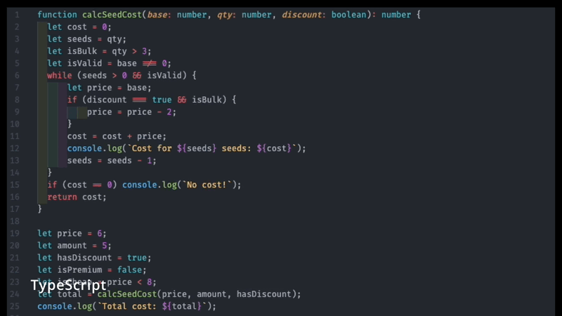

# MD Prettify: Turn Your Crappy Code into a Daily Delight! 🎉
<sub>Based on [prettify-symbols-mode](https://github.com/siegebell/vsc-prettify-symbols-mode)</sub>

Sick of staring at the steaming pile of garbage that is your "favorite" project's code? 
Can’t get your team to agree on whether to use !! or Boolean()? 
Tired of endless arguments over code style? 


Say hello to MD Prettify—the extension that slaps a shiny new coat of paint on your source code without ever touching the actual mess underneath! 🎨✨
 
[Download MD Prettify](https://marketplace.visualstudio.com/items?itemName=drboria.md-prettify)

### How Does This Magic Trick Work? 🪄

MD Prettify is your escape hatch from the chaos of ugly code and petty debates. 
It’s a **Visual Studio Code extension** that lets you prettify your source code—visually transforming it into something cleaner and more stylish—without changing a single character of the actual file. 
Think of it as a makeover for your codebase: all the glamour, none of the refactoring drama.

## Settings

### Commands

The following commands are available for keybinding:
* `md-prettify.enablePrettySymbols`: Flip the magic ON globally.
* `md-prettify.disablePrettySymbols`: Kill the vibe (why tho?).
* `md-prettify.togglePrettySymbols`: Toggle the magic for the line the cursor is on.

### Reveal On

By default, "ugly" text lights up when contacted by a cursor. 
Customize it with **mdPrettify.revealOn** globally or per-language with a revealOn setting in the language entry. Here’s the lineup:

*  **cursor**: Symbols shine when your cursor grazes them (default).
*  **cursor-inside**: Glows when your cursor’s chilling inside the symbol.
*  **active-line**: Every symbol on the cursor’s line gets the spotlight.
*  **selection**: Symbols dazzle when selected or cursor-touched.
*  **none**: Keep it stealth—no reveal, just raw code vibes.

## Configuration Examples

Explore pre-configured substitution settings for various languages in the [examples/](./examples) directory:


*   **[TypeScript looks like Python](./examples/typescript-to-python.json):** Example substitutions for TypeScript to make it look like [Python](https://docs.python.org/3/tutorial/index.html).
*   **[TypeScript looks like TrumpScript](./examples/typescript-to-python.json):** Example substitutions for TypeScript to make it look like [TrumpScript](https://github.com/samshadwell/TrumpScript).
*   **[TypeScript looks like YoptaScript](./examples/typescript-to-yoptascript.json):** Example substitutions for TypeScript to make it look like [YoptaScript](https://github.com/samgozman/YoptaScript).
*   **[TypeScript looks like LOTRScript](./examples/typescript-to-LOTRScript.json):** Example substitutions for TypeScript to make it look like LotrScript (no links, I just made it).

### Predefined Config
use ```mdPrettify.predefinedConfig: "value"``` to activate predefined config

* **typescript-to-python** — Make TypeScript strut like Python. 🐍
* **typescript-to-trumpscript** — Turn TypeScript into bold TrumpScript swagger. 🦁
* **typescript-to-yoptascript** — Flip TypeScript to quirky YoptaScript chaos. 😎
* **typescript-to-lotrscript** — Flip TypeScript to middle age with LOTRScript. 😎



Feel free to contribute your own configurations for other languages!


## Custom Config

Complete guide, how to [Build Your Custom Config](./examples/custom-config.md)

## Support Me:

If you find this extension useful, please consider donating to support its development:

<a href="https://www.buymeacoffee.com/miki_du" target="_blank"></a>

<a href="https://etherscan.io/address/0x1A3471C0Fa1b8512b5423d3Bd715560639AF04Ea" target="_blank"></a>
